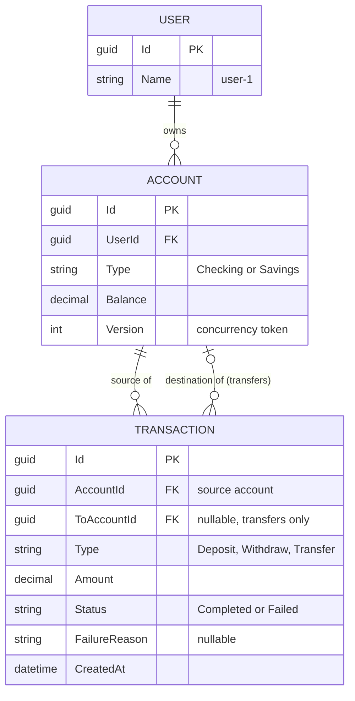

# ATM Application

 This is a web-based ATM application that lets a user manage two bank accounts. The goal is to showcase your software design and architecture within a focused scope.

## Requirements
- A web-based ATM interface supporting: deposit funds, withdraw funds, and transfer between the two accounts
- Track account balances and transaction history
- Single-user (no authentication required)

## Technical guidelines
- Backend: .NET 10 - C# 
- Frontend: Vuejs
- Database: SQLite

## Architecture

One ASP.NET Core minimal API (.NET 10, C#) calls three class libraries: **Accounts**, **Users**, **Transactions**. One SQLite file, normalized.

Rules that keep the libraries extractable:

- Each library uses vertical slices (one folder per use case holding request, handler, validator, endpoint mapping) with a small hand-written CQRS dispatcher (commands and queries). No MediatR.
- Slices are `internal`. Each library exposes only a small public contract (interfaces and DTOs).
- A module never reads another module's tables; it calls the other module's public contract.
- Each module has its own EF Core `DbContext` and owns its tables, all in the same SQLite file.
- A small `IUnitOfWork` shares one connection and transaction across the module contexts, so one operation (for example a transfer: debit, credit, history rows) commits or rolls back as one. SQLite supports ACID transactions.
- Account balances carry a concurrency token so two simultaneous operations cannot both pass the funds check.
- Mock data is seeded on startup: user `user-1` with Checking $1,500.00 and Savings $5,000.00, USD.

Cross-cutting:

- **Logging:** Serilog (console, and file under the data volume). Unexpected errors are logged with context.
- **Validation:** FluentValidation for data rules (amount greater than 0, accounts differ) and business rules (enough funds, account exists).
- **Errors:** validation and business failures return clear messages (for example "Account doesn't have enough funds"). Unexpected errors roll back, are logged, and return a generic message.
- **Health:** one `/health` endpoint that checks the DB and each module.
- **Money:** stored and computed as integer cents or `decimal`; never floating point. Builder's choice, as long as it is consistent.

## Data model

A user has many accounts; an account has many transactions. Transfers make the account-to-transaction link two columns: a transfer is one row that references both the source and the destination account. Each module owns its own tables.

The database is normalized with real foreign keys: `ACCOUNT.UserId`, `TRANSACTION.AccountId` and `TRANSACTION.ToAccountId`. There is no `UserId` on TRANSACTION; it is derivable through the account, so storing it would duplicate data.

Ownership: Users owns USER, Accounts owns ACCOUNT, Transactions owns TRANSACTION. The foreign keys live only in the database. In code, modules still never read each other's tables. History for a user works like this: Transactions asks the Accounts contract for the user's account ids, then loads transactions where `AccountId` or `ToAccountId` is one of them. Each module's migrations create its tables in dependency order (Users, Accounts, Transactions), because SQLite can only declare foreign keys when the table is created. If a module is ever extracted into its own service, the foreign keys to it are dropped and replaced by messaging or lookups; that is a known, bounded migration.

## Operations

All three run in-process inside one DB transaction and return the new balance(s) in the response.

- **Deposit:** add funds to the chosen account; record a transaction. Cents allowed.
- **Withdraw:** whole dollars only. Fails with "Account doesn't have enough funds" if the balance is too low.
- **Transfer:** between the two accounts (the "to" account is the other one). Cents allowed. Fails with the not-enough-funds reason if the source is short; otherwise debits one and credits the other.
- **History:** transactions for user-1 (date, type, account, amount, status). Status is Completed or Failed; failed business attempts are recorded as Failed with the reason (builder may choose to record only completed ones if simpler; flag it).
- **Balances:** both accounts.

## Frontend

Vue 3 + Vite, Vue Router, Bootstrap 5, Vitest. Branding: primary `#005e76`, dark navy `#0b223b`, errors `#dd7404` and success `#98b71b`, each for both text and border. Fonts: 'Fira Sans' and 'Fira Sans Condensed' (headings or compact labels, builder's choice). Other colors are the builder's call. Keep colors as CSS variables so they are easy to change.

Pages:

1. **Login:** "Enter" button, opens Home as user-1. A small "Reset demo data (demo only)" button restores the seed data (Checking $1,500.00, Savings $5,000.00) and clears history, after a confirm prompt.
2. **Home:** Deposit, Withdraw, Transfer, Balances & History, and an Exit button that returns to Login.
3. **Deposit / Withdraw:** account choice as buttons (Checking / Savings), amount entered on the ATM keypad, Submit, Cancel.
4. **Transfer:** "from" choice; the "to" account is the other one; amount on the keypad.
5. **Processing:** a "Processing..." spinner shown for at least 1 to 2 seconds (simulated in the Vue app; the API stays fast).
6. **Result:** success message with new balance(s) (transfer shows both), or the failure reason. A button returns to Login.
7. **Balances & History:** both balances and the transaction table, with Back.

Keypad: on-screen digits 0-9, Clear, Backspace, Enter, Cancel; the physical keyboard also works. Amount display behaves like an ATM: digits shift in from the right (1-0-0-0-0 shows $100.00), no decimal key. Withdraw amounts are whole dollars (keypad shows dollars only).

Validation runs in Vue for instant messages (amount greater than 0, transfer accounts differ) and again in the API, which is the authority.

## Other things to consider
- Serilog or other alternative open source for logging 
- FluentValidation for validations not only for data but also for business rules
- TDD for implementations
- Use Vertical slice for each microservice in order to follow the separation of concerns
- Simple code and the files should not contain more than 200 lines
- Include containers for the complete solution and a env.example and a docker compose file.
- Include a powershell script to run everything by setting some default values like passwords and so on in the env.example in order to test properly the application.

